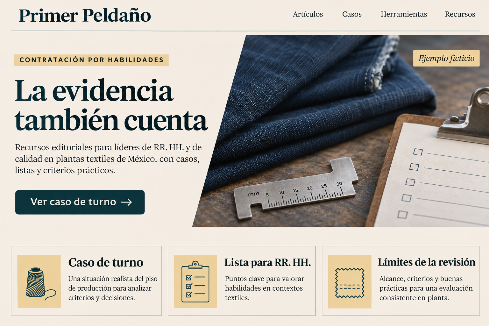
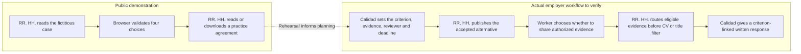
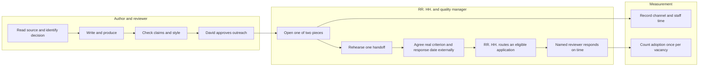

# Primer Peldaño · Week 16 Hardening

**David Buzali · Individual release defense · 25 November 2026**

## Build contract

Workers who learned on the job can lose access to a quality-control vacancy when the first CV screen ignores evidence of what they can do. The direct user is the RR. HH. lead drafting a second-shift textile quality-control posting in Mexico, working with the quality lead who owns the review criterion and response. The worker owns permission to share the example and pays MX$0. This is a concrete application of my commitment to reduce how unequal learning opportunities narrow the choices people have in Mexico.

**Release success.** In a fresh phone-sized browser, a first-time visitor can move from the fictional case to a four-choice agreement, identify the criterion, accepted evidence, reviewer and response window, and download it without sending a case or entering personal data. The visitor can use the core path by keyboard and find a five-slide defense at /about. Record expected and actual outcomes, fix and rerun the most consequential reproducible issue, and carry the result into the demo.

**Field success.** RR. HH. independently routes two equally eligible, authorized synthetic examples through its actual employer process before the usual CV or title filter. Calidad provides criterion-linked written reasons by the agreed date. The employer and the original records must establish that handoff. Real adoption has no verified count. Prioritize the handoff until it works without founder reminders, then check whether workers discover and understand the accepted alternative when they read the vacancy.

**Scope and architecture.** Keep the current Next.js, React and TypeScript venture and its existing Vercel project. The public home rehearsal uses allowlisted options, a browser-only agreement and a local text download. Keep the case, PDF checklist, guidance, earlier worker demo and pricing calculator. Harden observed failures and add the required defense at /about. The sprint excludes applicant intake, automated scoring, a live employer inbox and database expansion. The repository's optional owner-scoped Supabase migration remains outside the public flow. The editor checks claims offline before publication.

**Benchmark and adaptation.** Opportunity@Work’s STARs Hiring Playbook shows ways to include workers Skilled Through Alternative Routes. OCC’s publication guide places experience, schooling, skills and schedule before posting. Primer Peldaño localizes the decision to a plain-Spanish, second-shift textile example, uses a shareable log or self-authored description, and names the human reviewer and deadline ahead of worker effort. The two sources support the design rationale. Employer behavior and willingness to pay still require evidence.

- [Opportunity@Work STARs Hiring Playbook](https://www.opportunityatwork.org/take-action/psh/public-sector/stars-hiring-playbook)
- [OCC employer publication guide](https://supportcenter.occ.com.mx/hc/es/articles/41245639854737-Publica-tu-primera-vacante-en-OCC)

**Image-generated design reference.** This is the existing Week 15 concept of the editorial flow. Hardening keeps the design and retests how users move through it.

## Test plan and governing decisions

1. Walk from /caso through /#ensayo in a fresh mobile browser. Record view width, four selections, focus after submit, a completed text download and the exact output boundaries.
2. Submit the empty synthetic form and confirm it creates no agreement and sends no data. Rerun the Week 15 source-to-claim review against a private unsupported outcome claim. Trace the publication decision and use a sourced control.
3. Enter the rehearsal from the case with a keyboard. Check that focus and the next Tab move into the rehearsal, that every control is named, and that the result and download remain reachable. Validate route access, data boundaries and package checks. Run a source-grounded fictional RR. HH. screen walkthrough in a fresh chat and record its exact response in the existing persona evidence.
4. Keep the Week 16 team blueprint as a pre-session source. David’s proposal is to trace an authorized submission that disappears before Calidad. The demo tests the local workflow. Evidence from the employer’s actual route, a live team decision and peer dissent require records from those sessions.

**Final shadow clause.** At scale an employer could invite workers to spend time preparing evidence, quietly discard it at the title filter, or reuse it for undisclosed screening. Publish an actual opening, permitted evidence, a named human reviewer and a deadline before asking for effort. Ask for consent, minimize identifiers, restrict use to that opening, route eligible evidence before the title filter, and give written criterion-linked reasons. Pause expansion when a case disappears or a deadline is missed. The public demo takes only fixed synthetic choices and cannot send a hiring decision or retain an applicant record.

**Three-year direction.** Establish credible routing and response for this one role, then expand to adjacent roles with participating Mexican employers only when review is timely, consent and criterion consistency hold, and delivery effort supports a sustainable pilot. Track completion and access without creating a transferable worker score.

---

## Prior release evidence · Week 15 Business Bending

**David Buzali · Distribution and verified adoption · 19 November 2026**

## Strategy and build contract

Primer Peldaño's first audience is the manager of a Mexican textile plant who needs to fill a second-shift quality-control vacancy. RR. HH. drafts the posting and owns the first screen. The quality manager owns the evidence criterion and response. The employer is the possible pilot payer. Workers pay MX$0.

The decision occurs while drafting the vacancy, before a routine CV screen can exclude a worker who learned on the job. The manager needs a way to accept a permitted example of work, route it and get a human response. Primer Peldaño adds a one-vacancy agreement around the plant's existing recruiting process. We make no promise that using it will result in a hire.

OCC's employer guide documents where employers set experience, schooling, skills, duties and schedule. It establishes a decision point for the content, without evidence of any given plant's review behavior. Opportunity@Work's STARs Hiring Playbook is the global comparator. Primer Peldaño applies its skills-first approach to an existing Mexican recruiting workflow with plain Spanish, a second-shift textile example, a permitted shift log or work description, and a human review commitment.

- [OCC employer publication guide](https://supportcenter.occ.com.mx/hc/es/articles/41245639854737-Publica-tu-primera-vacante-en-OCC)
- [Opportunity@Work STARs Hiring Playbook](https://www.opportunityatwork.org/take-action/psh/public-sector/stars-hiring-playbook)

**Product success.** A first-time visitor can go from either outreach piece to a working rehearsal for one vacancy. They can choose a criterion, acceptable evidence, a reviewer role and a response window, then generate and download an agreement with synthetic options. They can also download the one-page RR. HH. checklist, see the limits of the process and locate the Week 14 calculator and evidence demo.

**Field success.** One verified adoption per real vacancy requires RR. HH. to route at least one eligible application using the agreed alternative before the usual CV screen, and the named reviewer to respond against the published criterion by the agreed date. Introductions, opens, downloads and written commitments are earlier events. A committed vacancy waiting for a case remains pending.

**Scope and architecture.** Extend the Week 14 Next.js/TypeScript app at its normal entry point. Keep the calculator at /tarifa and the worker demo at /evidence. The public Week 15 route uses labeled invented data and fixed client-side options. It has no form submission, storage, tracker, applicant upload, employer inbox, hiring score or new database/API dependency.

**Mockup.** The pre-code concept uses the built-in image generator. The prompt specified an editorial web mockup with a cream-and-teal layout, textile still life, fictional-example label and three resource cards. The implemented page is the reference for behavior.

## Brand

1. Write for RR. HH. and the quality lead in everyday Mexican Spanish. Name the role, task and shift.
2. Describe a visible action and its owner. Make the next step usable inside a form and spreadsheet.
3. State the source or evidence status near each claim. Use “ejemplo ficticio” where a reader might mistake a scenario for a result.

**Weak line** “Nuestra IA encuentra al mejor talento sin sesgos.”  
**Rewrite** “Antes de filtrar por CV, acuerden qué evidencia puede aceptar RR. HH. y quién responderá por el turno de calidad.”

**Design.** Deep navy #102D3F for copy, teal #0E625B for action, warm paper #F5F0E6 for reading, amber #EED8A7 for examples and limits. Serif display headings distinguish the editorial hierarchy from compact sans-serif steps and controls. Each piece opens with the hiring moment, states its evidence status, makes the handoff visible and ends with the same action. “Vacante,” “turno,” “bitácora” and “RR. HH.” fit the local workplace. The layout works on a phone and as paper at the start of a shift.

## Six concepts

| Series | Finished this week | Planned next |
| --- | --- | --- |
| Caso de turno | Web walkthrough of a defect report from application to a criterion-linked response | “Una bitácora sin nombre comercial.” Rehearse with a permitted, redacted example. |
| Antes de publicar | One-page printable checklist for RR. HH. and the quality lead | “La fecha de respuesta también se publica.” Check reviewer coverage before opening a vacancy. |
| Límites de la revisión | Web field note on permission, evidence gaps and human review | “Qué decir cuando la evidencia no basta.” Name the missing detail and a permitted alternative. |

## Content production and evidence

**Real input to useful output.** OCC asks employers to choose experience and minimum schooling, optionally list skills, and describe duties and schedule. We identified the decision just before publishing and asked who would route acceptable evidence before the first screen. The RR. HH. checklist adds a criterion, acceptable evidence, owner and deadline to the existing workflow. Its defect example is fictional. This is a design inference from OCC's documentation.

| Role | Input | Output | Quality check |
| --- | --- | --- | --- |
| Research | OCC employer guide and Week 15 brief | Sourced decision point and labeled audience hypothesis | Source describes these publication fields |
| Writing | Decision point, RR. HH. and quality roles | Scenario, checklist and boundaries note | Every piece names its operator and next step |
| Visual production | Reviewed copy and palette | Responsive HTML and printable PDF | Readable on phone and at letter size |
| Evidence and claim review | Drafts, source, team shadow conditions | Claims marked sourced, fictional or pending | Remove unsupported savings and hiring claims |
| Style review | Claim-checked pieces | Consistent Mexican Spanish and shared CTA | Labels, role names and status language match |
| Revision and approval | Test notes and updated pieces | Version reviewed by David before outreach | Links and labels checked, intended recipients opted in |

## Distribution and honest results

Start with one opt-in channel, one-to-one WhatsApp to relevant Mexican textile hiring managers who consented to receive the material. Share the case and PDF checklist using the same next action. Log unique deliveries and replies, voluntary confirmation of an open or download when shared, a real vacancy commitment, routing, response and total staff minutes. Use coded records outside the site, report aggregates and keep applicant records out of the log. If a later broad post is possible, compare the same example and next action at comparable staff effort. Deduplicate across routes and vacancies.

**Expectation.** A concrete handoff example before publication should invite more useful replies than a generic pitch. The first sign is a real employer naming a vacancy and a reviewer. The separate proposed efficiency threshold is at least 20% less staff time for five criterion-linked responses with review quality preserved. The 8% example and illustrative outreach results in Brain Bending are hypothetical.

**Observed at packet kickoff.** No field distribution was documented. Reach, clicks and captures are unmeasured and verified adoptions have no evidenced count. A test that has yet to run has no reply rate. Keep the bounded next step. If opt-in readers open the pieces and do not propose a role or vacancy, ask which handoff decision is missing before making more content.

## Blueprint, test plan and three-year direction

The five-founder blueprint supplied for the week is a pre-session draft. It calls for permission-based outreach, meaningful action, visible evidence status, and no unverified hiring judgment or exposed applicant records. The Week 15 public workflow applies those conditions. Attendance, peer mismatch and decisions require a record of the live session.

Mechanically test the two piece links, the synthetic rehearsal, blank selection, invalid options, download/reset, legacy routes and evaluator access on desktop and phone. Use a fresh conversation to simulate one source-grounded RR. HH. user, record observed confusion in the tested workflow, and fix and retest any reproduced problem. Keep the simulated walkthrough distinct from the audience test.

In three years, Primer Peldaño could help several employers make permitted, worker-controlled evidence review routine. Expand roles and shop-floor contexts after a verifiable handoff, preserved review quality and manageable delivery effort. Growth must respect worker consent and keep review accountable to a human.

## Release evidence and outreach handoff

- [Production release](https://week-15-primer-peldano.vercel.app/)
- [Source and commit history](https://github.com/davidbuzali/week-15-primer-peldano)
- [Finished case](https://week-15-primer-peldano.vercel.app/caso)
- [Finished print checklist](https://week-15-primer-peldano.vercel.app/semana-15/lista-rh.pdf)
- [Finished limits of review](https://week-15-primer-peldano.vercel.app/revision)
- [Shared next action](https://week-15-primer-peldano.vercel.app/#ensayo)

**Message A for an opted-in contact.** “Hola. Te comparto el caso de una costura abierta para una vacante de calidad en segundo turno. Es ficticio y muestra cómo RR. HH. puede canalizar una descripción a Calidad antes del filtro de CV. Al final puedes ensayar el acuerdo. ¿Te serviría al preparar una vacante?” [Caso de turno](https://week-15-primer-peldano.vercel.app/caso)

**Message B for an opted-in contact.** “Te comparto una lista de una página para acordar criterio, evidencia, responsable y fecha con Calidad antes de publicar. El PDF enlaza al mismo ensayo. ¿Qué punto necesitarías resolver primero?” [Lista para RR. HH.](https://week-15-primer-peldano.vercel.app/semana-15/lista-rh.pdf)

**Actual field result.** No distribution was executed in this build. Reach, clicks, captures and real adoptions are unmeasured. Approval and opted-in delivery remain field steps.

**Synthetic anonymized log example for practicing the reporting method.** These entries are invented and excluded from actual results.

| Code | Piece | Illustrative action | Adoption |
| --- | --- | --- | --- |
| SIM-01 | Case | Acknowledges reading and asks who should receive the case | Unverified, no live handoff |
| SIM-02 | Checklist | No reply in the example window | Unverified, no live handoff |

In the synthetic example, two messages go out, one recipient acknowledges reading, no clicks are instrumented, and no adoption is verified. The example shows why an acknowledgement can help improve wording without proving workflow use.

**Test and response.** The same-chat synthetic persona asked how to move from the rehearsal to a real vacancy. The result and download now tell RR. HH. to confirm eligibility, recipient and date with Calidad before publishing. Mechanical evidence is in docs/TESTING.md and the simulation is in docs/PERSONA.md.

**Deployment history.** The [first release](https://vercel.com/davidbuzali/week-15-primer-peldano/BNuQW8hnCAtbp266h7eFcoCkR6Gr) shipped the case, checklist, review guidance and rehearsal. The [second release](https://vercel.com/davidbuzali/week-15-primer-peldano/3QEHXdHbEDuU5nMJq8V7pD2z7qtB) included the user-facing handoff clarification and regression tests. The production alias is the evaluator link.

**Mechanical evidence.** Thirty-three automated tests pass. The production rehearsal rejected a blank form, generated the selected values and cleared them on reset. At 390 × 844 the document had no horizontal overflow. The revised result and export text carry the same internal-channel instruction. The in-app browser did not confirm a file save event.
