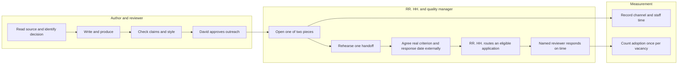

# Primer Peldaño · Week 15 Business Bending

**David Buzali · Distribution and verified adoption · 19 November 2026**

## Strategy and build contract

Primer Peldaño's first audience is the manager of a Mexican textile plant who needs to fill a second-shift quality-control vacancy. RR. HH. drafts the posting and owns the first screen. The quality manager owns the evidence criterion and response. The employer is the possible pilot payer. Workers pay MX$0.

The decision occurs while drafting the vacancy, before a routine CV screen can exclude a worker who learned on the job. The manager needs a way to accept a permitted example of work, route it and get a human response. Primer Peldaño adds a one-vacancy agreement around the plant's existing recruiting process. We make no promise that using it will result in a hire.

OCC's employer guide documents where employers set experience, schooling, skills, duties and schedule. It establishes a decision point for the content, without evidence of any given plant's review behavior. Opportunity@Work's STARs Hiring Playbook is the global comparator. Primer Peldaño applies its skills-first approach to an existing Mexican recruiting workflow with plain Spanish, a second-shift textile example, a permitted shift log or work description, and a human review commitment.

- [OCC employer publication guide](https://supportcenter.occ.com.mx/hc/es/articles/41245639854737-Publica-tu-primera-vacante-en-OCC)
- [Opportunity@Work STARs Hiring Playbook](https://www.opportunityatwork.org/take-action/psh/public-sector/stars-hiring-playbook)

**Product success.** A first-time visitor can go from either outreach piece to a working rehearsal for one vacancy. They can choose a criterion, acceptable evidence, a reviewer role and a response window, then generate and download an agreement with synthetic options. They can also download the one-page RR. HH. checklist, see the limits of the process and locate the Week 14 calculator and evidence demo.

**Field success.** One verified adoption per real vacancy requires RR. HH. to route at least one eligible application using the agreed alternative before the usual CV screen, and the named reviewer to respond against the published criterion by the agreed date. Introductions, opens, downloads and written commitments are earlier events. A committed vacancy waiting for a case remains pending.

**Scope and architecture.** Extend the Week 14 Next.js/TypeScript app at its normal entry point. Keep the calculator at /tarifa and the worker demo at /evidence. The public Week 15 route uses labeled invented data and fixed client-side options. It has no form submission, storage, tracker, applicant upload, employer inbox, hiring score or new database/API dependency.

**Mockup.** Image-generated UI concept requested before implementation. Attach it here after visual review. The implemented page and approved copy are the reference for behavior.

## Brand

1. Write for RR. HH. and the quality lead in everyday Mexican Spanish. Name the role, task and shift.
2. Describe a visible action and its owner. Make the next step usable inside a form and spreadsheet.
3. State the source or evidence status near each claim. Use “ejemplo ficticio” where a reader might mistake a scenario for a result.

**Weak line** “Nuestra IA encuentra al mejor talento sin sesgos.”  
**Rewrite** “Antes de filtrar por CV, acuerden qué evidencia puede aceptar RR. HH. y quién responderá por el turno de calidad.”

**Design.** Deep navy #102D3F for copy, teal #0E625B for action, warm paper #F5F0E6 for reading, amber #EED8A7 for examples and limits. Serif display headings distinguish the editorial hierarchy from compact sans-serif steps and controls. Each piece opens with the hiring moment, states its evidence status, makes the handoff visible and ends with the same action. “Vacante,” “turno,” “bitácora” and “RR. HH.” fit the local workplace. The layout works on a phone and as paper at the start of a shift.

## Six concepts

| Series | Finished this week | Planned next |
| --- | --- | --- |
| Caso de turno | Web walkthrough of a defect report from application to a criterion-linked response | “Una bitácora sin nombre comercial.” Rehearse with a permitted, redacted example. |
| Antes de publicar | One-page printable checklist for RR. HH. and the quality lead | “La fecha de respuesta también se publica.” Check reviewer coverage before opening a vacancy. |
| Límites de la revisión | Web field note on permission, evidence gaps and human review | “Qué decir cuando la evidencia no basta.” Name the missing detail and a permitted alternative. |

## Content production and evidence

**Real input to useful output.** OCC asks employers to choose experience and minimum schooling, optionally list skills, and describe duties and schedule. We identified the decision just before publishing and asked who would route acceptable evidence before the first screen. The RR. HH. checklist adds a criterion, acceptable evidence, owner and deadline to the existing workflow. Its defect example is fictional. This is a design inference from OCC's documentation.

| Role | Input | Output | Quality check |
| --- | --- | --- | --- |
| Research | OCC employer guide and Week 15 brief | Sourced decision point and labeled audience hypothesis | Source describes these publication fields |
| Writing | Decision point, RR. HH. and quality roles | Scenario, checklist and boundaries note | Every piece names its operator and next step |
| Visual production | Reviewed copy and palette | Responsive HTML and printable PDF | Readable on phone and at letter size |
| Evidence and claim review | Drafts, source, team shadow conditions | Claims marked sourced, fictional or pending | Remove unsupported savings and hiring claims |
| Style review | Claim-checked pieces | Consistent Mexican Spanish and shared CTA | Labels, role names and status language match |
| Revision and approval | Test notes and updated pieces | Version reviewed by David before outreach | Links and labels checked, intended recipients opted in |

## Distribution and honest results

Start with one opt-in channel, one-to-one WhatsApp to relevant Mexican textile hiring managers who consented to receive the material. Share the case and PDF checklist using the same next action. Log unique deliveries and replies, voluntary confirmation of an open or download when shared, a real vacancy commitment, routing, response and total staff minutes. Use coded records outside the site, report aggregates and keep applicant records out of the log. If a later broad post is possible, compare the same example and next action at comparable staff effort. Deduplicate across routes and vacancies.

**Expectation.** A concrete handoff example before publication should invite more useful replies than a generic pitch. The first sign is a real employer naming a vacancy and a reviewer. The separate proposed efficiency threshold is at least 20% less staff time for five criterion-linked responses with review quality preserved. The 8% example and illustrative outreach results in Brain Bending are hypothetical.

**Observed at packet kickoff.** No field distribution was documented. Reach, clicks and captures are unmeasured and verified adoptions have no evidenced count. A test that has yet to run has no reply rate. Keep the bounded next step. If opt-in readers open the pieces and do not propose a role or vacancy, ask which handoff decision is missing before making more content.

## Blueprint, test plan and three-year direction

The five-founder blueprint supplied for the week is a pre-session draft. It calls for permission-based outreach, meaningful action, visible evidence status, and no unverified hiring judgment or exposed applicant records. The Week 15 public workflow applies those conditions. Attendance, peer mismatch and decisions require a record of the live session.

Mechanically test the two piece links, the synthetic rehearsal, blank selection, invalid options, download/reset, legacy routes and evaluator access on desktop and phone. Use a fresh conversation to simulate one source-grounded RR. HH. user, record observed confusion in the tested workflow, and fix and retest any reproduced problem. Keep the simulated walkthrough distinct from the audience test.

In three years, Primer Peldaño could help several employers make permitted, worker-controlled evidence review routine. Expand roles and shop-floor contexts after a verifiable handoff, preserved review quality and manageable delivery effort. Growth must respect worker consent and keep review accountable to a human.
